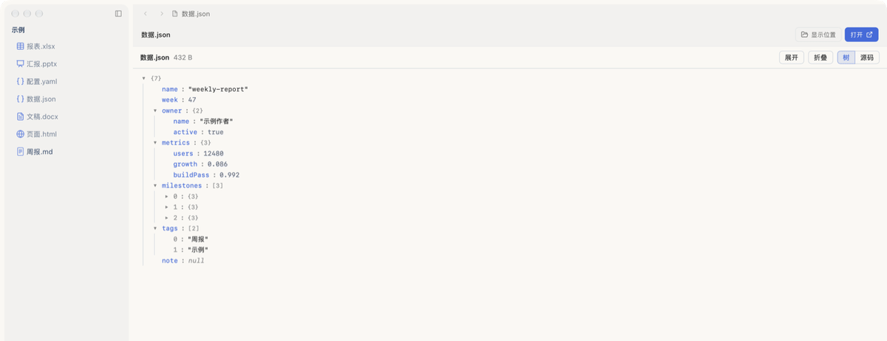

<div align="center">

# Ignorance for Typora

一套干净的 Typora 2.0 主题，加上演示、图表、文件预览和格式转换。<br>
能在主题里实现的放在主题，主题做不到的放在扩展。


[主题](#主题) · [扩展](#扩展) · [文件预览](#文件预览) · [安装](#安装) · [开发](#开发) · [限制](#限制)

<br>


</div>

<br>

## 主题

八套配色各有浅色和深色，导出 HTML 同样生效。

<div align="center">

</div>

<table>
<tr>
<td width="50%"></td>
<td width="50%"></td>
</tr>
</table>

| 方面 | 内容 |
|---|---|
| 主题选项 | 设置 ▸ 视图：阅读宽度、段落节奏、双猫、标题编号、表格十字高亮、墨水屏 |
| 提示块 | note、tip、important、warning、caution，各有图标和配色 |
| 容器 | 用 `::: 名称` 书写。说明类：note、info、tip、success、warning、danger、question、important。布局类：kpi、cols、tabs、details、card、chapter、compare。流程类：timeline、steps、process、roadmap |
| 层级 | 目录不用缩进，靠字号、字重和明暗区分层级。嵌套引用撑满父级宽度、文字左对齐，靠底色叠加和引号变淡区分。嵌套列表缩进收窄，靠字号和标记颜色区分 |
| 属性卡 | 前置信息的卡片样式，字段表单里 title、author、date、tags、source 等各有图标 |
| 侧栏与面板 | 左侧栏和右侧面板是圆角悬浮卡片，文件树按文件类型显示不同图标 |
| 其他 | 引用、表格、代码、行内标记的统一样式 |

## 扩展

| 功能 | 说明 |
|---|---|
| 演示面板 | 按 `---` 或标题分页；支持版式注释、脚注、图标短码、KaTeX 公式；可全屏放映 |
| 演示里的图表 | 内置绘制 ` ```chart ` 代码块（Typora 官方图表格式）的柱状、折线、饼图，配色跟随主题 |
| 演示里的 Mermaid 图 | 内置绘制 ` ```mermaid ` 的流程图（`graph` / `flowchart`）、序列图、饼图、甘特图，配色跟随主题 |
| 文件预览 | 在文件树里点开非 Markdown 文件，在编辑区预览，见下节 |
| 格式化 | 命令「中英文之间加空格」 |
| 片段与模板 | 徽章片段；汇报模板 |

## 文件预览

文件树默认只列 Markdown 和纯文本。要显示其他文件，在设置 ▸ 文件把文件树过滤改为「全部文件」（`files.treeFileFilterMode = 'all'`），改完重启 Typora。

| 类型 | 扩展名 | 预览方式 |
|---|---|---|
| 结构化数据 | json、yaml、yml、toml、xml | 可折叠的树，可切到源码；出错时显示错误并回到源码 |
| 代码与网页 | html、htm、css、js、mjs、cjs、ts、tsx、jsx、py、java、go、rs、c、cpp、h、sh、zsh、sql、ini | 带行号和简易着色的源码，可编辑并保存（Tab 缩进、⌘S）；HTML 另有预览模式 |
| Office 文档 | docx、xlsx、pptx | 只读：docx 转为文档，xlsx 按工作表显示，pptx 按页显示文字 |

<div align="center">

</div>

图片、音频、视频和 PDF 使用 Typora 自带预览；csv、tsv 可用 Typora 官方的 CSV Viewer 扩展。

## 安装

需要 macOS、zsh、Python 3、Typora 2.0.0-beta1。

```bash
zsh scripts/install.sh
```

主题复制到 `~/.config/Typora/Themes/ignorance`，`advanced/` 下的两个扩展（`ignorance.advanced`、`ignorance.file-viewers`）以软链接放到 `~/.config/Typora/Extensions/`，装完重启 Typora。

卸载：

```bash
REMOVE=1 zsh scripts/install.sh
```

## 开发

```bash
npm install
npm test
node scripts/check-styles.mjs
zsh scripts/build-theme.sh
zsh scripts/build-store.sh
```

`theme/ignorance/` 和 `store/` 是构建产物，不进版本库。`build-store.sh` 按 Typora 扩展商店的目录结构组装主题包 `themes/ignorance-shiyao.ignorance/` 和扩展包 `extensions/ignorance.file-viewers/`、`extensions/ignorance.advanced/`，供提交到 [typora/typora-extensions](https://github.com/typora/typora-extensions) 使用；尚未提交。`ignorance.advanced` 不打包图表库（演示里的图表和流程图为内置绘制），整包约 1.2 MB，也在构建范围内。

| 路径 | 内容 |
|---|---|
| `theme/src/` | 主题源码：`theme.css`、`base.toml`（颜色与元素）、`layout.toml`（阅读宽度、段落节奏、标题编号、十字高亮、墨水屏）、`mascot.toml`（双猫） |
| `theme/assets/` | 构建时内联为 data URI 的图片 |
| `advanced/ignorance.advanced/` | 扩展：演示面板（内置图表与流程图）、行内徽章、格式化命令、片段、模板 |
| `advanced/ignorance.file-viewers/` | 扩展：json、yaml、toml、代码、网页、Office 文档的预览（`viewers/`） |
| `theme/store/` | 主题商店包的清单、说明和封面图 |
| `scripts/` | 构建与安装脚本、八套配色生成器、样式检查 |
| `tests/` | 单元测试（`node --test`） |

## 限制

<details>
<summary>主题与编辑器</summary>

- 扩展不能改编辑器 DOM，编辑器里的交互只能靠主题 CSS 实现。
- 行内徽章、悬停显示、注音、面包屑在编辑器里隐藏 `((类型:` 与 `))`，鼠标悬停该行时显示；悬停显示未在实机用真实鼠标验证。
- 官方 Mermaid 扩展在编辑器里不能画节点文字里带 `<br>` 的图（报「The renderer did not return valid SVG」），这是官方扩展的限制，演示里可以画。
- 演示里的图表只支持 bar、line、pie，不支持 bar 与 line 混画；Mermaid 只支持流程图（含嵌套 `subgraph`，不支持连到 subgraph 本身）、序列图、饼图、甘特图，类图、状态图、ER 图等显示源码；甘特图不支持 `excludes`、`axisFormat`、`todayMarker`（会被忽略）和 `YYYY-MM-DD` 以外的日期格式，序列图不支持 `box`、`create`、`destroy`、`link`；超出范围时显示源码。
- 属性块默认以 YAML 源码显示，这是 Typora 渲染器写死的默认值，主题和扩展都改不了，需要在每篇文档里手动切到字段表单。
- 属性字段表单里 `cssclasses` 等列表项前的「- 」是 YAML 数据本身，样式去不掉。
- 侧栏和右侧面板的内部元素只能通过主题配色键调整。
- 导出的 HTML 只有一种明暗。
- Word 导出走 Pandoc，不带主题样式。
- `tabs` 容器在编辑器里是各页签上下堆叠，不能切换；`details` 容器在编辑器里不折叠。

</details>

<details>
<summary>文件预览</summary>

- HTML 预览里页面脚本不执行，相对路径的样式和图片不加载。
- 代码着色是简易正则，不处理 HTML 内嵌的 script 与 style。
- Office 预览只支持 docx、xlsx、pptx。xlsx 日期显示为序列号、公式只显示缓存值、不合并单元格；pptx 看不到图片与图表；docx 的页眉页脚、文本框会丢失。

</details>

## 许可

本项目代码使用 MIT 许可，见 [LICENSE](LICENSE)。`advanced/ignorance.advanced/vendor/` 里的 KaTeX、Lucide，以及 `advanced/ignorance.file-viewers/viewers/` 里的 js-yaml、smol-toml、jszip、mammoth，各自保留原许可文件。
